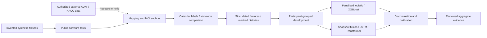

# YOAD research software

Auditable research software for **24-month dementia progression in mild cognitive impairment (MCI)**. YOAD began with an interest in younger-onset Alzheimer's disease; the current source also covers general-MCI snapshot, longitudinal and multimodal prediction. An onset-defined YOAD cohort is not established by enrollment age alone.

**Status: source release with synthetic software verification; independent participant-level scientific reproduction remains blocked.** This is a research project, not a clinically validated diagnostic system. No model performance or clinical benefit is certified by this repository.

## Scientific question

How do outcome construction, prediction anchoring and representations change discrimination, calibration and apparent modality value when evaluation targets and participants are comparable? Earlier-onset progression motivates the project, but demonstrating value for that population requires reliable onset information and sufficient authorized data.

ADNI was investigated for model development and NACC for potential independent validation. Their dictionaries, endpoints and modality availability differ. They are not pooled here, and completed external validation is not claimed. The candidate gap is methodological sensitivity to label/timing/representation choices; novelty remains subject to a refreshed primary-source literature review.

## Architecture



The public package contains actual migrated implementations, not a new set of empty model modules. Original source identities and adaptations are in [SOURCE_MANIFEST.csv](AUDIT/SOURCE_MANIFEST.csv).

## Methods and models

The code includes calendar-based three-state outcomes, examination-date and VISCODE handling, NACC mapping, missing-code recoding, dated clinical features, MRI/biomarker mappings, fold-only preprocessing and participant-grouped validation. Unknown outcomes remain indeterminate. Calendar and visit-code definitions answer different questions.

Penalised logistic regression was considered the earlier primary model and XGBoost a comparator. Existing later modules include snapshot early/late fusion, LSTM, temporal Transformer and missing-modality gated fusion. The Simkhada reference protocol is a documented local reimplementation; adapted settings are distinct from exact reproduction. Clinical/cognitive predictors may overlap diagnosis construction, so diagnostic circularity remains an unresolved scientific concern.

Evaluation code covers AUROC, average precision, Brier/log loss, calibration intercept/slope and O:E, threshold metrics, participant-cluster bootstrap and full-pipeline refitting bootstrap. Fitting, tuning, calibration and threshold selection must stay separate from evaluation. Historical reused held-out evaluation is internal, not fresh external validation.

## Findings and verification

No independently reproduced participant-level finding is established by this release. Older no-run summaries coexist with later source-reported ADNI runs. Later manuscript audits still require private prediction/interval verification, clinical/date review, targeted exclusions and a conventional history-summary comparator. They do not establish NACC validation, biological specificity or clinical utility.

Results are classified as **A** independently reproduced, **B** previously reported and awaiting independent reproduction, **C** synthetic software tests, or **D** pending/blocked. Current scientific claims are B/D; the tests here are C. Read the [evidence ledger](docs/experiment_status.md), [limitations](docs/limitations.md) and [actual software test report](AUDIT/TEST_RESULTS.md).

## Install and run

Python 3.11 is the tested interpreter line. From a clone:

```bash
python3.11 -m venv .venv
source .venv/bin/activate
python -m pip install -r requirements.txt
python -m pip install --no-deps .
python -m pytest -q -p no:cacheprovider
python scripts/publication_scan.py
python -m yoad.benchmark.runner configs/benchmark/synthetic_smoke_test.yaml
```

The CLI above only accepts synthetic data. Its metrics are software diagnostics, not study results. Restricted dataset runners and original private freezes are excluded; this checkout cannot recreate participant-level findings without approved data and a separately reviewed protocol. Dataset paths are explicit function inputs; explanatory path contracts are in `configs/`. [Reproducibility instructions](docs/reproducibility.md) explain the boundary.

## Repository guide

| Path | Content |
|---|---|
| `AUDIT/` | Complete inventory decisions, duplicate/large-file reports, source provenance and tests |
| `docs/` | Research question/gap, literature scope, hypotheses, methods, status and governance |
| `configs/` | Explanatory study contracts and executable synthetic benchmark configs |
| `src/yoad/` | Data, preprocessing, features, models, evaluation, multimodal/longitudinal, audit, reporting and visualization libraries |
| `experiments/` | Baseline, longitudinal, multimodal and robustness implementation guides |
| `tests/` | Invented fixtures and software tests |
| `scripts/` | Publication scanner |
| `notebooks/` | Explicit notebook exclusion rationale |
| `results/` | Evidence status and provenance boundaries; no private research outputs |

## Roadmap and governance

Complete approved private prediction verification and raw clinical/timing review; run separately versioned instrument exclusions and the history-summary comparator; obtain fresh independent evaluation; update the literature and disclosure review; resolve contributor/institutional licensing rights. Do not treat these steps as completed experiments.

Obtain ADNI/NACC data separately under applicable agreements. No participant tables, MRI images, private predictions, checkpoints, credentials or correspondence are redistributed. [Data governance](docs/data_governance.md) and [PUBLICATION_AUDIT.md](PUBLICATION_AUDIT.md) state the release boundary. Original research files are preserved.

## Citation and references

Use [CITATION.cff](CITATION.cff) and record the exact commit when citing this software. No manuscript publication or DOI for this repository is asserted. The motivating Simkhada DOI and verification limitations are in the [literature scope](docs/literature_review.md); historical quantitative comparisons are not repeated here. Rights are reserved under [LICENSE](LICENSE); this is not an open-source license.
